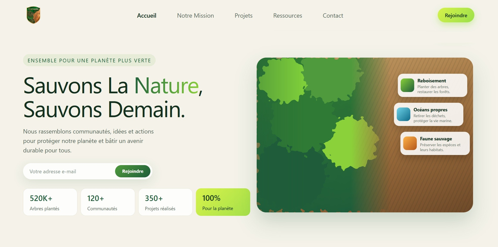

<div align="center">

# La Canopée

**Protégeons la faune et la flore, ensemble.**

Prototype fonctionnel de site web associatif dédié à la protection de la nature, avec un design « papier déchiré » peint à la main, des pages complètes et un espace membre.


</div>

---

## Aperçu

<div align="center">



**[Ouvrir le site en ligne](https://la-canopee-green.vercel.app/)**

</div>

---

## Sommaire

- [À propos](#à-propos)
- [Fonctionnalités](#fonctionnalités)
- [Technologies](#technologies)
- [Pages et routes](#pages-et-routes)
- [Structure du projet](#structure-du-projet)
- [Installation](#installation)
- [Variables d'environnement](#variables-denvironnement)
- [Scripts](#scripts)
- [Authentification](#authentification)
- [Design](#design)
- [Déploiement](#déploiement)
- [Limites actuelles et prochaines étapes](#limites-actuelles-et-prochaines-étapes)
- [Auteur](#auteur)
- [Licence](#licence)

---

## À propos

**La Canopée** est un site web pour une association de protection de la faune et de la flore. Il rassemble communautés, idées et actions pour protéger la planète et bâtir un avenir durable.

Le projet est parti d'une simple page HTML et a été transformé en vrai site **Next.js** avec plusieurs pages, un menu responsive et un système de comptes membres complet.

---

## Fonctionnalités

- 5 pages publiques : Accueil, Notre mission, Projets, Ressources, Contact
- Espace membre : inscription, connexion, mot de passe oublié, réinitialisation, page de compte protégée
- Design « peinture » unique : cartes à bords déchirés, titres manuscrits, dégradés verts
- Menu hamburger responsive, dans le même style que le site
- Images aux dimensions uniformes, coins arrondis, cadrage réglable par photo
- Formulaire de contact avec validation côté client et côté serveur
- Mode sombre automatique selon les préférences du système
- Accessibilité de base : libellés, rôles ARIA, respect de `prefers-reduced-motion`
- SEO : titres par page et description via l'API Metadata de Next.js

---

## Technologies

| Catégorie | Outils                                                         |
| --------- | -------------------------------------------------------------- |
| Framework | Next.js 16 (App Router, Turbopack)                             |
| Interface | React 19                                                       |
| Langage   | TypeScript                                                     |
| Style     | CSS pur (variables, grid, flexbox, filtres SVG)                |
| Back-end  | Route Handlers Next.js (`app/api`)                             |
| Sécurité  | `crypto` Node.js : hachage `scrypt`, cookie signé HMAC SHA-256 |
| Images    | Unsplash                                                       |

Aucune librairie CSS ni UI : tout le style est écrit à la main.

---

## Pages et routes

| Route                     | Description                                           |
| ------------------------- | ----------------------------------------------------- |
| `/`                       | Accueil : hero, mission, initiatives, newsletter      |
| `/mission`                | Notre mission et chiffres clés                        |
| `/projets`                | Projets phares et projets en cours                    |
| `/ressources`             | Guides et documents à consulter                       |
| `/contact`                | Formulaire de contact                                 |
| `/register`               | Création de compte (derrière le bouton « Rejoindre ») |
| `/login`                  | Connexion                                             |
| `/forgot-password`        | Demande de lien de réinitialisation                   |
| `/reset-password?token=…` | Choix d'un nouveau mot de passe                       |
| `/compte`                 | Espace membre (protégé)                               |

API :

| Méthode | Route                | Rôle                                |
| ------- | -------------------- | ----------------------------------- |
| POST    | `/api/auth/register` | Créer un compte                     |
| POST    | `/api/auth/login`    | Se connecter                        |
| POST    | `/api/auth/logout`   | Se déconnecter                      |
| POST    | `/api/auth/forgot`   | Générer un lien de réinitialisation |
| POST    | `/api/auth/reset`    | Enregistrer le nouveau mot de passe |
| POST    | `/api/contact`       | Envoyer un message de contact       |

---

## Structure du projet

```
la-canopee/
├── app/
│   ├── api/
│   │   ├── auth/            # register, login, logout, forgot, reset
│   │   └── contact/
│   ├── compte/
│   ├── contact/
│   ├── forgot-password/
│   ├── login/
│   ├── mission/
│   ├── projets/
│   ├── register/
│   ├── reset-password/
│   ├── ressources/
│   ├── globals.css          # tout le design du site
│   ├── layout.tsx           # navbar + footer + métadonnées
│   └── page.tsx             # accueil
├── components/
│   ├── AuthForm.tsx         # formulaire réutilisable (auth et contact)
│   ├── Brand.tsx
│   ├── Footer.tsx
│   ├── LogoutButton.tsx
│   ├── MobileMenu.tsx       # menu hamburger
│   ├── Navbar.tsx
│   ├── NavLinks.tsx
│   ├── NewsletterBox.tsx
│   ├── PageHead.tsx
│   ├── Paint.tsx            # carte « peinture »
│   └── SvgDefs.tsx          # filtres SVG du papier déchiré
├── lib/
│   ├── auth.ts              # sessions, hachage, jetons
│   ├── data.ts              # contenu des cartes
│   └── validate.ts          # validation e-mail et mot de passe
├── public/
│   └── apercu.jpg           # image d'aperçu du README
├── .env.example
├── next.config.ts
├── package.json
└── tsconfig.json
```

---

## Installation

Prérequis : **Node.js 20 ou plus récent** et **npm**.

```bash
# 1. Cloner le dépôt
git clone https://github.com/Dravix89/la-canopee.git
cd la-canopee

# 2. Installer les dépendances
npm install

# 3. Créer le fichier d'environnement
cp .env.example .env.local        # Windows PowerShell : copy .env.example .env.local

# 4. Lancer le serveur de développement
npm run dev
```

Ouvrir ensuite [http://localhost:3000](http://localhost:3000).

---

## Variables d'environnement

Fichier `.env.local` à la racine :

| Variable      | Description                                                     |
| ------------- | --------------------------------------------------------------- |
| `AUTH_SECRET` | Longue chaîne aléatoire servant à signer les cookies de session |

Pour générer une valeur sûre :

```bash
node -e "console.log(require('crypto').randomBytes(48).toString('hex'))"
```

Ne jamais publier `.env.local` (déjà ignoré par `.gitignore`).

---

## Scripts

| Commande        | Action                                             |
| --------------- | -------------------------------------------------- |
| `npm run dev`   | Serveur de développement (rechargement instantané) |
| `npm run build` | Build de production                                |
| `npm start`     | Lance le build de production                       |

---

## Authentification

- Mots de passe hachés avec **scrypt** et un sel aléatoire
- Session stockée dans un cookie `httpOnly`, `sameSite=lax`, `secure` en production, signé en **HMAC SHA-256**, valable 7 jours
- Jetons de réinitialisation à usage unique, valables 1 heure, stockés sous forme de hash
- Réponse identique à « mot de passe oublié » que le compte existe ou non, pour ne pas révéler les comptes
- Validation faite côté client et côté serveur

---

## Design

Le style repose sur une identité visuelle propre :

- **Palette** : vert forêt `#1f5d3a`, vert vif `#4f9a3d`, citron `#d6f24a`, fond crème `#f4f2e9`
- **Cartes « peinture »** : bords déchirés générés par des filtres SVG (`feTurbulence` et `feDisplacementMap`), dégradés et taches de peinture
- **Titres de cartes** : police manuscrite italique
- **Responsive** : grille en 3 colonnes sur ordinateur, 1 colonne sur mobile, menu hamburger sous 900 px
- **Thème** : variables CSS avec mode sombre automatique

---

## Déploiement

Voir le site : [https://la-canopee-green.vercel.app/](https://la-canopee-green.vercel.app/)

---

## Limites actuelles et prochaines étapes

Le projet est une base solide, certaines parties sont volontairement simplifiées :

- [ ] **Base de données** : les comptes sont stockés en mémoire et perdus à chaque redémarrage. À remplacer par une vraie base (Prisma, Drizzle, Supabase...)
- [ ] **E-mails** : le lien de réinitialisation s'affiche dans la console. À brancher sur un service d'envoi (Resend, Postmark...)
- [ ] **Formulaire de contact** : les messages sont affichés dans la console. À envoyer par e-mail ou à stocker
- [ ] **Newsletter** : redirige vers l'inscription, à relier à un outil d'e-mailing
- [ ] **Ressources** : liens de téléchargement à renseigner
- [ ] **Optimisation des images** : passer de `` à `next/image`
- [ ] **Tests** : ajouter des tests (Playwright, Vitest)

Sur Vercel, le stockage en mémoire est réinitialisé fréquemment : une vraie base de données est indispensable pour un usage réel des comptes.

---

## Auteur

**David Roussety**

GitHub : [github.com/Dravix89](https://github.com/Dravix89)

---

## Licence

Projet distribué sous licence **MIT**. Vous pouvez l'utiliser, le modifier et le partager librement, en conservant la mention de l'auteur.
Les photos proviennent d'[Unsplash](https://unsplash.com/) et restent la propriété de leurs auteurs.
